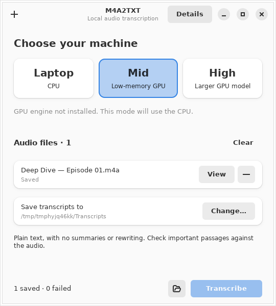

# M4A2TXT

Local M4A-to-text conversion using your own CPU or GPU. The extracted **M4A Scribe 0.2.0-preview** provides a GTK 4 / libadwaita desktop with **Laptop / Mid / High** presets and a batch CLI backed by Whisper.

The source lives in [`m4a-scribe/`](m4a-scribe/). Start with its [setup and usage guide](m4a-scribe/README.md).



Actual GTK window from the [automated UI check](https://github.com/QSOLKCB/M4A2TXT/actions/runs/41537925273), with example audio. This shows the compact layout and a completed fixture job; it is not a GPU performance result.

## Get started

From the repository root, or the top of an extracted [Linux package](PACKAGING.md):

```sh
./m4a2txt
```

Select **Laptop**, **Mid**, or **High**, use the clearly labelled one-time setup button if needed, and drop audio files onto the window.

On Ubuntu 24.04+, run `./install-deps.sh` once if the native dependencies are missing. `./m4a2txt --check` checks your local setup without downloading anything. See [package instructions](PACKAGING.md) for extraction, verification, and rebuilding the deterministic archive. The package uses your operating system's Python, GTK and FFmpeg; it installs the selected model and builds its engine during explicit first-time setup.

After setup, transcription runs locally without a cloud service, chat interface, or HTTP server. Model installation is a separate, explicit operation. The application exports plain UTF-8 `.txt` files without adding summaries or rewriting the recognizer's text.

## Source and evidence

| Location | Contents |
| --- | --- |
| [`m4a-scribe/`](m4a-scribe/) | Extracted app, setup scripts, tests, and documentation |
| [`m4a-scribe/DESIGN.md`](m4a-scribe/DESIGN.md) | Architecture and implementation stages |
| [`m4a-scribe/VALIDATION.md`](m4a-scribe/VALIDATION.md) | Executed checks and remaining validation |
| [`archive/`](archive/) | Original uploaded bundle and its checksum |

This remains a source preview. The test suite covers the local pipeline, desktop queue, cancellation, setup choices, and real GTK widget flows. See the validation record and GitHub Actions for executed results. GPU operation and full-length Audio Overview accuracy still require validation on the target machine.

## Verify the extraction

```sh
(cd archive && sha256sum -c SHA256SUMS)
(cd m4a-scribe && sha256sum -c SHA256SUMS)
```

The original compressed bundle is preserved byte-for-byte. The application now develops in `m4a-scribe/`; its current checksums are separate from the retained preview baseline in `validation/preview-0.1.0-SHA256SUMS`.

## Licences

The repository's existing [Apache 2.0 licence](LICENSE) is retained. The imported M4A Scribe package keeps its original [MIT licence](m4a-scribe/LICENSE). Upstream Whisper, whisper.cpp, and the installed FFmpeg build retain their respective notices; their weights and binaries are not included in this repository.
