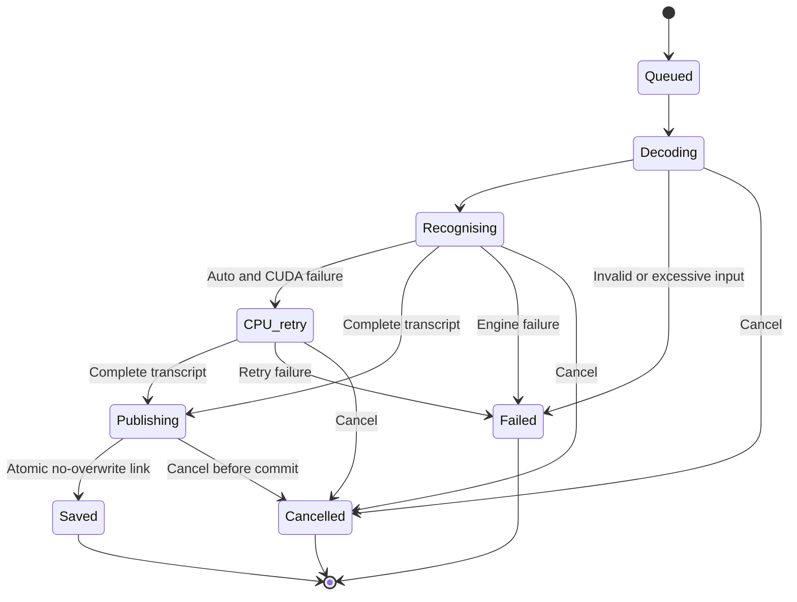

# M4A2TXT design

Design baseline: 3 November 2026. Target: a local Ubuntu desktop utility that turns Audio Overview `.m4a` exports into plain UTF-8 text. The AI is a speech recognition component, with no conversational interface or external inference service.

## User experience

The normal task is: select Laptop, Mid, or High; choose CPU or GPU; add or drop audio files; click Transcribe; open the resulting text. The application remembers the selected preset, processor and output folder independently. A batch runs one file at a time to keep memory use predictable.

The interface has one native GTK window: three model presets, a CPU/GPU toggle, file queue, destination, Transcribe and Cancel, and an optional Details window. Completed jobs show their processor/backend and open a read-only transcript with copy and playback controls. Model paths, language codes, and compiler flags stay out of the normal flow. The desktop uses English; the CLI retains its language option.

The desktop uses GTK 4.10+ and libadwaita 1.4+ through the OS PyGObject packages. Native controls follow the desktop light/dark preference. The launcher uses system Python so activated virtual environments do not hide the GI bindings. No Tk, web server, browser wrapper, JavaScript runtime, or pip environment is required for the desktop.

## Components

| Component | Responsibility | Boundary |
| --- | --- | --- |
| GTK desktop / CLI | Three presets, CPU/GPU choice, queue, presentation, cancellation | Explicit setup is separate from offline transcription; no HTTP server |
| Python core | Validate local input, supervise children, publish complete text | Calls executables with argument arrays, not a shell |
| FFmpeg | Decode local media to canonical audio | File/pipe protocols only; explicit demuxer; no network inputs |
| whisper.cpp CPU executable | Run Whisper with GPU disabled | Independent CPU build |
| whisper.cpp CUDA executable | Run with NVIDIA CUDA backend selection checked | Separate build; same model and transcript interface |
| Setup scripts | Build pinned engine and install chosen model | Network use is explicit and confined to setup |

No transport API is required. UI-to-core calls are ordinary Python calls and an in-process event queue; core-to-engine communication uses process arguments, temporary files, and logs. No port is bound, including localhost. The OS desktop and audio stack can use their normal local IPC.

## Job state and publication

The file publication operation is the completion boundary. Cancellation before it publishes nothing for that job. Cancellation after it cannot retract a completed transcript. A cancelled batch preserves earlier completed files. The GUI can finish reporting a completed job even if a cancellation arrives just after publication.

Atomic hard-link publication avoids the race in “check whether a name exists, then overwrite it.” A collision selects a new name. Publication is currently restricted to filesystems that support this operation. Input filenames remain data, including spaces, quotes, Unicode, and shell metacharacters.

## Recognition policy

The initial defaults are English transcription, temperature zero, temperature fallback disabled, no initial prompt, no grammar constraints, no VAD, and no translation. Do not introduce cleanup by a second language model. These choices make the app's transformations inspectable; they are not a promise of exact recognition or bit-identical results across CPU and GPU.

The text returned by whisper.cpp is the exported text, including its punctuation and line breaks. The app must not repair a speaker's factual mistakes or calculations. Whisper may itself normalize speech, omit hesitations, or hallucinate; exact experimental quotations still need audio review.

Laptop selects `small.en` with at most four CPU threads. Mid selects quantized `large-v3-turbo-q5_0` with at most four CPU threads. High selects unquantized `large-v3` with at most eight CPU threads. Actual thread counts are capped by the host CPU count. Processor selection is independent: either CPU or GPU for every preset, with no implicit CPU retry in the desktop. Laptop + CPU is the initial default, including CPU for migrated settings that have no saved device. Presets are resource choices, not measured accuracy or throughput rankings.

Do not infer speaker identity from alternating sentences or stereo channel layout. The two hosts may be mixed into both channels. Reliable speaker turns require a separately evaluated local diarization system; host names require explicit user assignment. Plain text is useful without this additional model.

## Local operation

Normal transcription has no download code or cloud fallback. The GUI shows a labelled Set up button when the selected preset lacks an engine or model, together with the expected model download size. Only that explicit action invokes the existing setup scripts. It never transcribes automatically afterward, installs OS packages, or changes drivers. The core transcription path never invokes setup. The shipped build configuration disables whisper.cpp's CURL and server support and ggml's RPC backend. Custom executable paths are a user-controlled trust boundary; arbitrary replacement executables are not guaranteed to be offline.

The app preserves the original audio and decodes a private copy. Temporary decoded audio can be larger than the compressed source: 16,000 samples/second × 2 bytes gives about 115 MB per hour before the recognizer's in-memory representation and model buffers. Whole-file decoding has a four-hour preview cap. OS crashes may leave temporary material; no secure-erasure claim is made.

The batch queue is in memory. Completed jobs are excluded from subsequent batches; cancelled and failed jobs remain eligible for an explicit retry. The worker publishes events and the GTK main thread alone updates visible jobs. Closing requests cancellation and keeps the window alive until the worker finishes cleanup. Settings store the selected preset, processor and output folder only. No transcript database, telemetry, remote analytics, or cloud account is part of the design. Setup can be completed elsewhere and transferred, subject to compatible binaries and normal dependency installation.

## GPU and CPU behaviour

CLI Auto selects the installed CUDA executable first and retries the entire file once on the independent CPU executable if the first attempt fails or does not report CUDA. It reuses the decoded PCM and the same model; no partial transcript from the first attempt is combined with the retry. The reason for fallback is reported. The desktop uses explicit CPU or GPU instead.

GPU uses the CUDA executable without a CPU retry. The wrapper incrementally monitors the pinned engine's complete bounded diagnostic stream for CUDA backend selection, stopping the process if initialization explicitly fails or reports no GPU. GPU output cannot be published without a CUDA selection report. Logging must remain enabled for this path; CPU retains `--no-prints`. The report confirms backend selection, not exclusive GPU execution or a per-kernel measurement. These diagnostic strings are a version-specific contract and must be rechecked on an engine upgrade. A later native worker could expose structured backend metadata directly.

For the user's NVIDIA desktop, CUDA is the intended accelerated path. On machines without a working proprietary driver/toolkit combination, CPU remains usable. Available VRAM and driver compatibility must be measured on the real machine; neither the GPU model name nor an installed `nvcc` alone establishes a successful inference path.

## Release stages

| Stage | Deliverable | Exit condition |
| --- | --- | --- |
| Starter, archived | Local batch CLI, original Tk window, FFmpeg decode, Whisper adapter, safe output | Retained 0.1.0 bundle and CPU smoke record |
| GTK update, included here | Three presets, drag-and-drop, explicit setup, safe retries, transcript review | Regression tests and a real GTK widget smoke test under Xvfb |
| CUDA controls, included here | Independent CPU/GPU selection, explicit engine setup, CUDA backend report checks | Routing/failure tests, native GTK checks, CUDA compilation; hardware acceptance remains separate |
| Hardware validation | RTX GPU run and Ryzen CPU run using representative episodes | Capture actual backend, wall time, peak RAM/VRAM, and reviewed transcript differences |
| Transcript review | Segment timestamps and seek-to-audio; manual edits saved separately | Raw machine output retained; timestamps map to original audio |
| Evidence exports | Optional JSON receipt with source/model/engine/output hashes and settings | Metadata stays out of `.txt`; failed runs cannot claim complete evidence |
| Desktop release | Versioned package, launcher, installed-runtime paths | Clean Ubuntu install and offline launch tested; dependencies/licences accounted for |

The app does not implement diarization, timed transcript seeking, manual editing, evidence sidecars, watch folders, resumable jobs, or a prebuilt installer. These are separate additions and are not necessary to make the basic file-to-text workflow useful.

## Acceptance checks

1. A representative `.m4a` produces one complete UTF-8 `.txt` with no app-added text.
2. Existing files and source audio remain unchanged, including output-name collisions and cancellation.
3. Invalid, empty, special-file, and excessive-duration inputs fail without a successful transcript.
4. Setup completes with explicit downloads; later transcription succeeds with outbound networking blocked. Static separation alone is not a network-isolation test.
5. GPU failure has a visible, bounded CPU retry in CLI Auto; explicit CPU never requests GPU; explicit GPU never publishes a result without CUDA backend evidence or silently retries on CPU.
6. Review held-out excerpts containing Australian accents, names, numbers, hesitations, overlap, profanity, silence, and music. Record omission, insertion, and substitution errors against an independently checked reference.
7. Include opening and closing words, and several long episodes, in coverage checks. Do not infer long-file reliability from a short speech fixture.
8. Label results by model, exact engine revision, device, settings, and hardware. A tiny-model smoke test is not a quality benchmark for large-v3-turbo.

Primary dependency references and installation details are in [README.md](README.md).
